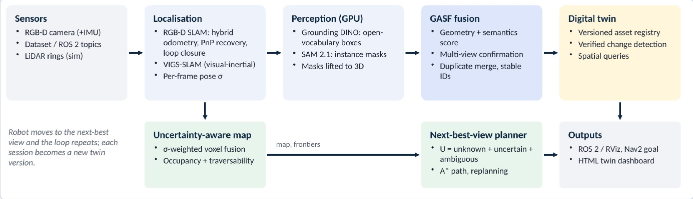
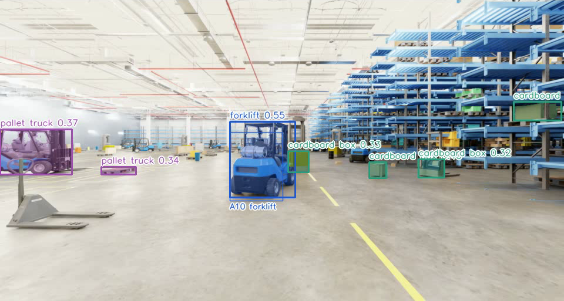
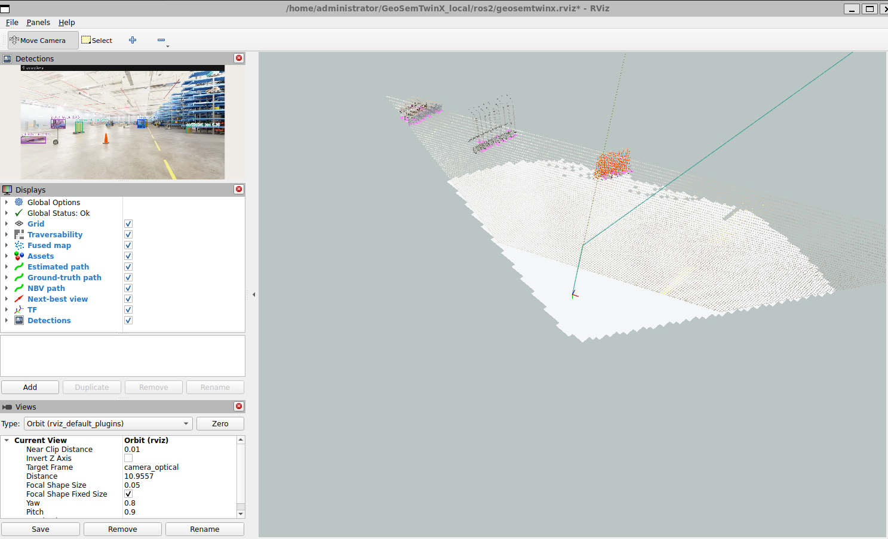
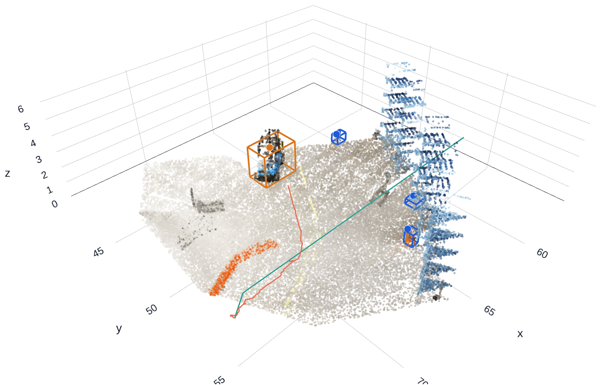
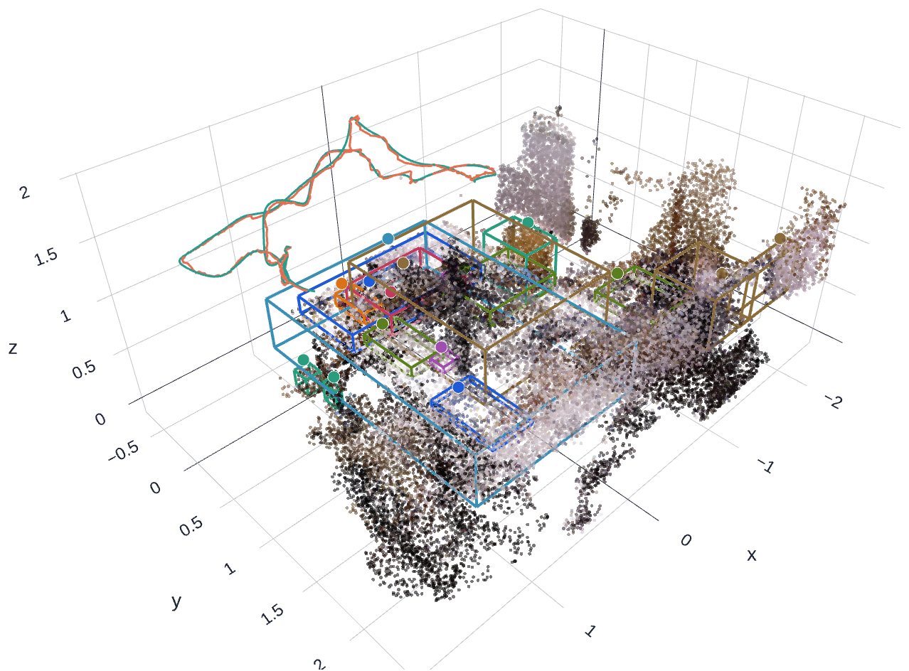
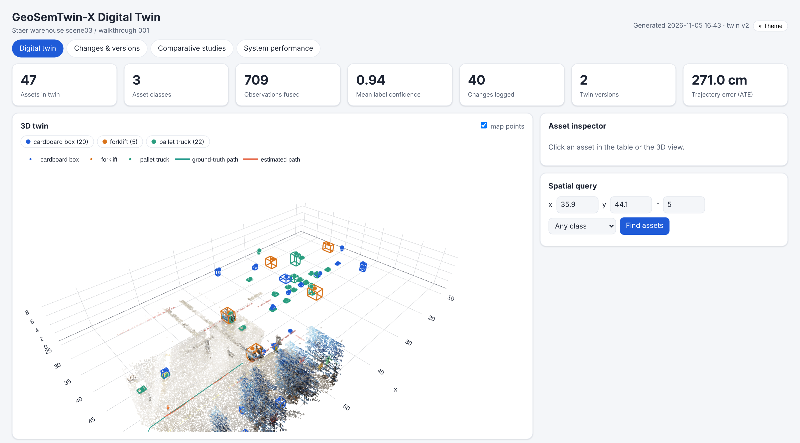

# GeoSemTwin-X

**Geometry-grounded semantic SLAM → persistent, versioned digital twin of a warehouse.**

GeoSemTwin-X turns an RGB-D (+IMU) stream from a moving robot into a digital twin: a 3D map plus a registry of
physical assets (forklifts, pallets, boxes, pallet trucks), each with one stable ID, class, confidence and 3D box.
Sessions are stored as versions, changes between sessions are verified against occupancy evidence, and a
next-best-view planner tells the robot where to look next. Everything runs on one laptop GPU and is exposed through
ROS 2 and an interactive HTML dashboard.



| Detection + segmentation with persistent twin IDs | Live ROS 2 demo (RViz2) |
|---|---|
|  |  |
| **Staer warehouse: 3D map, assets, trajectories** | **TUM office twin** |
|  |  |



## Key ideas

* **GASF, geometry-aware semantic fusion.** Observations are matched to assets with
  `S = 0.25·sem + 0.35·overlap + 0.20·centroid + 0.20·geo` (Hungarian assignment). Assets are confirmed only after
  ≥ 2 hits from ≥ 2 views, fragments are merged and labels are confidence-weighted. Geometry decides identity;
  semantics names it.
* **Uncertainty end to end.** Per-frame pose σ from the SLAM information matrix, depth noise σ<sub>z</sub>(z), and voxel
  weights `w = σz(z)⁻² · exp(−σpose / 0.1)`. Frames with step σ > 0.15 m are gated out.
* **Verified change detection.** "Removed" and "added" require the location to be *observed free*; "moved" requires
  occupancy evidence in both sessions. Anything else is reported as "unverified".
* **Next-best-view exploration.** `U = (wu·unknown + ws·uncertain + wa·ambiguous)·e^(−0.15·d)`, with A* over the
  traversability grid and multi-ring LiDAR replanning. Goals are published for Nav2.
* **Open vocabulary.** Grounding DINO + SAM 2.1 are prompted with class names, so no training data is needed.

## Results (summary)

Full tables: [`docs/RESULTS_REPORT.md`](docs/RESULTS_REPORT.md).

**Semantic fusion (synthetic warehouse, 22 assets, mean of 3 seeds)**

| Method | Objects | Precision | Recall | F1 | Duplicates / asset | ID switches | mIoU |
|---|---:|---:|---:|---:|---:|---:|---:|
| Independent 2D labelling | 289 | 0.08 | 1.00 | 0.14 | 10.60 | 237 | 0.28 |
| Geometry-only clustering | 21 | 0.55 | 0.52 | 0.53 | 0.46 | 7 | 0.20 |
| Centroid tracking | 29 | 0.71 | 0.94 | 0.81 | 0.29 | 33 | 0.33 |
| **GASF (ours)** | **22** | **0.81** | 0.82 | **0.81** | **0.11** | 9 | **0.35** |

GASF ablation (F1): full 0.81 · w/o duplicate merge 0.76 · w/o multi-view gate 0.59 · w/o geometry terms 0.34.

**Other studies**

| Study | Result |
|---|---|
| SLAM, TUM fr1/desk (ATE) | 2.9 cm (odometry only 7.3 cm; ORB-SLAM2 1.6, ElasticFusion 2.0, DVO-SLAM 2.1 published) |
| Drift robustness (Staer, 40 cm pose noise) | Duplicates / asset: GASF 0.18 vs centroid tracking 0.36 vs per-frame 3.73 |
| Staer, detector threshold 0.20 | GASF F1 0.30 / duplicates 0.08 / identity consistency 0.85; centroid 0.29 / 0.31 / 0.69 |
| Map quality (Staer, GT poses) | 99.3% of points within 5 cm vs 91.5% naive; p90 error 2.1 vs 4.7 cm; completeness 89% vs 100% |
| Change detection (synthetic) | Precision 1.00 / recall 0.83 with occupancy verification (0.56 / 0.83 without); 0 false alarms on a static revisit |
| Exploration (80 m budget) | Coverage: NBV 27.6%, nearest frontier 28.0%, random 19.0% |
| Compute (RTX 3500 Ada) | 0.8 FPS end to end; detection 354 ms / keyframe; GASF 3 ms / keyframe; 74 W GPU; 2.9 GB GPU memory |

**Known limitations.** RGB-D SLAM runs on the CPU, so the pipeline is not real-time. Staer walkthrough 001 is a straight,
constant-velocity pass: both our RGB-D SLAM (ATE 2.7 m, scale 1.3×) and VIGS-SLAM mono+IMU (5.0 m, 2.3×) lose
scale there, and LiDAR fusion is the planned fix. Grounding DINO tiny reaches only 19% recall on Staer's small or
distant assets. NBV coverage matches the frontier baseline but does not exceed it.

## Repository layout

```
geosemtwinx/     core package
  data.py          TUM / Staer / synthetic dataset readers
  synthetic.py     ray-cast synthetic warehouse with scripted changes
  slam.py          RGB-D SLAM: hybrid odometry, PnP recovery, loop closure, pose graph, per-frame σ
  vigs_bridge.py   export to / import from VIGS-SLAM
  detectors.py     Grounding DINO + SAM 2.1 (and a simulated detector for tests)
  gasf.py          3D lifting, GASF fusion, baselines
  mapping.py       uncertainty-weighted voxel map, occupancy, traversability
  change.py        verified change detection
  twin.py          digital twin, versions, spatial queries, twin store
  nbv.py           next-best-view planner and exploration simulator
  evaluation.py    precision / recall / F1, duplicates, identity, mIoU
  compare.py       comparative studies, ablations, plots
  streaming.py     LiveTwin (frame-by-frame pipeline)
  demo.py          offline demo video
  dashboard.py     self-contained HTML dashboard
  power.py         GPU power / memory monitor (nvidia-smi)
scripts/run_all.py one entry point for every experiment
ros2/            ROS 2 node, dataset player, RViz2 config, run_demo.sh
configs/         parameters for Staer, TUM and Intel RealSense D435i
notebooks/       Google Colab version of the prototype
docs/            run guide, beginner's guide, fundamentals primer, results report, images
```

## Quick start

Tested on WSL2 Ubuntu 24.04 with ROS 2 Jazzy, an NVIDIA RTX 3500 Ada (12 GB), Python 3.12 and PyTorch (CUDA 12.6).

```bash
git clone https://github.com/<your-username>/GeoSemTwinX.git ~/GeoSemTwinX
cd ~/GeoSemTwinX
source /opt/ros/jazzy/setup.bash      # optional: only needed for the ROS 2 demo
bash setup.sh                         # ffmpeg, .venv (sees ROS 2), PyTorch CUDA, requirements
source .venv/bin/activate
hf auth login                         # account that accepted the staerrobotics/warehouses terms
python scripts/run_all.py check
```

Run the experiments (results are written to `results/`):

```bash
python scripts/run_all.py tum                                   # SLAM study + office twin        (~20 min)
python scripts/run_all.py vigs-export --vigs-root /path/to/VIGS-SLAM
#   run VIGS-SLAM on the export (see docs/RUN_GUIDE.md), then:
python scripts/run_all.py staer --change-walk 002 --vigs-traj /path/to/vigs/out   # warehouse studies (~30 min)
python scripts/run_all.py staer --change-walk 002                # same, without the VIGS-SLAM comparison
python scripts/run_all.py synthetic                             # fusion, change, exploration     (~50 min)
python scripts/run_all.py demo                                  # demo video                      (~10 min)
python scripts/run_all.py report                                # results/REPORT.md
python scripts/run_all.py diagnose                              # check Staer stream alignment
```

Live ROS 2 demo (dataset player → GeoSemTwin-X node → RViz2):

```bash
bash ros2/run_demo.sh staer      # or: tum | realsense
ros2 service call /geosemtwinx/save_twin std_srvs/srv/Trigger    # writes the twin store + Live_Dashboard.html
```

Topics: `/geosemtwinx/{pose,path,map,assets,traversability,nbv_goal,nbv_path,annotated,status}`, TF `map → camera_optical`.

The step-by-step guide for Windows + WSL + VS Code, with troubleshooting, is in [`docs/RUN_GUIDE.md`](docs/RUN_GUIDE.md).

## Documentation

* [`docs/RUN_GUIDE.md`](docs/RUN_GUIDE.md): running everything, viewing outputs, troubleshooting
* [`docs/GeoSemTwinX_Beginners_Guide.pdf`](docs/GeoSemTwinX_Beginners_Guide.pdf): how the system works, what was
  implemented, how to read every result, presentation tips
* [`docs/GeoSemTwinX_Fundamentals_Primer.pdf`](docs/GeoSemTwinX_Fundamentals_Primer.pdf): background on cameras, SLAM,
  mapping, deep learning, detection, segmentation, data association, uncertainty, exploration, evaluation and ROS 2
* [`docs/RESULTS_REPORT.md`](docs/RESULTS_REPORT.md): every result table

## Datasets

Datasets are downloaded by the code and are **not** included in this repository.

* [TUM RGB-D benchmark](https://cvg.cit.tum.de/data/datasets/rgbd-dataset), fr1/desk (CC BY 4.0)
* [Staer Robotics warehouses](https://huggingface.co/datasets/staerrobotics/warehouses), scene03 walkthroughs 001 and 002
  (gated: accept the terms on Hugging Face first)
* Synthetic warehouse: generated by `geosemtwinx/synthetic.py`

## Acknowledgements

Built on [Open3D](https://www.open3d.org/), [Grounding DINO](https://github.com/IDEA-Research/GroundingDINO),
[SAM 2](https://github.com/facebookresearch/sam2), [Hugging Face Transformers](https://github.com/huggingface/transformers),
[ROS 2](https://docs.ros.org/) and [VIGS-SLAM](https://github.com/cvg/VIGS-SLAM) (used as an external baseline). Each of
these projects has its own licence.

## Licence

MIT, see [`LICENSE`](LICENSE).
